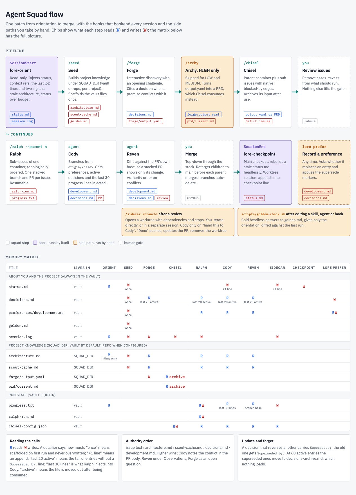
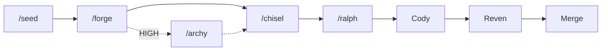

# Agent Squad

A personal multi-agent development workflow for Claude Code.

**In plain words:** Agent Squad is a team of AI agents that takes a piece
of software work from a rough idea to a reviewed pull request. One agent
helps plan the work, one designs it when it is complex, one splits it into
tracked issues, one writes the code, and a separate one reviews it before
anything is merged. Nothing is merged without a person approving it. It is not a
demo: I use it every day on real projects, including client work. In
company environments it can run fully hands-off from company tools, with
no write access to the tracker or the repository (see
[Tracker modes](#tracker-modes)).

Forge -> Archy -> Chisel -> Ralph -> Cody -> Reven

On an existing branch: `claude -w <branch>` opens a worktree through hooks
and you iterate in conversation (see "Working on an existing branch" below)

/challenge -> Challenge, standalone, any time (stress-tests a proposal or
piece of writing before you commit to it — see "Challenge" below); also
runs as a required step inside `/forge` before a draft scope closes.

## MVP Flow

```text
/seed           First contact: create the vault mapping, initialize .squad/ AND scaffold second-brain project files.
                (The SessionStart hook orients each session; `/lore start` is setup/repair only.)
/clear          Reset session context.
/forge          Interactive discovery, writes output.yaml.
/archy          (HIGH only) Create PRD.
/chisel         Create tracker issues (GitHub in connected mode, a local batch file in detached mode).
/ralph          Execute issues in dependency order (invokes Cody). Connected: one stacked branch and PR per issue; detached: one branch per dependency chain.
                `/ralph --parent <n>` runs a container's sub-issues (default: most recent open container); `/ralph #1 #2` runs named issues.
                Skips `blocked` and `needs-review` issues unless named explicitly.
                Reviews every PR with Reven and runs fix rounds (cap `chisel.ralph.review_rounds`, default 2; the issue gets the `needs-review` label when out of rounds or after a second `INCOMPLETE`); `--no-review` skips it, `--review-context "<text>"` adds batch-wide context for Reven.
                Persists run state (order, branches, attempt and review-round counters) in `.squad/ralph-run.md` and offers resume.
Cody            Implement one issue on a branch cut from origin/<base> (local <base> in detached mode), with preferences and active decisions injected; open its PR.
Reven           Review each PR against its own base (stacked PRs show only their diff).
SessionEnd      lore-checkpoint hook (async) rebuilds status.md when stale (worktree sessions append a checkpoint only); /lore recover rebuilds explicitly.
                The same hook lints decisions.md: it adds the inverse marker for `Supersedes:` lines and leaves findings for the next SessionStart (see docs/lore-decisions.md).

Checks (this repo)
Tier 1 (gate)   bash scripts/squad-lint.sh
                bash scripts/test-squad-labels.sh ; bash scripts/test-squad-branch.sh
                (and the other scripts/test-*.sh; hook-tests.yml on ubuntu + macOS, squad-lint.yml on ubuntu only)
Tier 2 (advisory) claude plugin eval claude/ ...   (see "Evals (tier 2)"; never gates a PR)
```


[](https://giorgiogalassi.github.io/agent-squad/flow.html)

The full picture, including the hooks, the side paths and a matrix of
which step reads and writes which memory file, lives in
[`docs/flow.html`](docs/flow.html), rendered at
<https://giorgiogalassi.github.io/agent-squad/flow.html>. The spine is:



The diagram shows the current manual MVP: `Lore` manages second-brain memory, `Seed` prepares context, `Forge`
structures the work, `Archy` appears only for `HIGH` complexity, `Chisel`
creates tracker issues (GitHub issues in connected mode, or a local batch
file in detached mode), `Ralph` drives execution through `Cody` — one
stacked branch and PR per issue in connected mode, one branch per
dependency chain in detached mode — and `Reven` reviews each PR against
its base before merge.

## Working on an existing branch

The MVP flow above is sized for a batch of tracker issues. It's the wrong
tool for "this UI piece is wrong on the branch I already have out" —
re-running Forge and Chisel just to describe a fix to a branch that
already exists is pure ceremony.

Claude Code opens the worktree natively and the plugin's hooks do the
rest (the former Sidecar skill is retired):

```bash
claude -w <branch> -n <ticket>     # open (attach to the branch if it exists)
# ... iterate in conversation; ask for a push or a PR when you want one ...
/exit                              # clean worktree: removed; dirty: refused
claude -w <branch> --resume        # pick the work up again
```

- **Open** (`WorktreeCreate` hook, `worktree.sh hook-create`): if `<branch>`
  is an existing local or origin branch the worktree attaches to it,
  otherwise a new branch of that name is created. `node_modules` is cloned
  (reflink or clonefile where available), the files `.worktreeinclude`
  lists are copied, and lockfile staleness is recorded.
- **Orient** (`SessionStart` hook, `lore-orient.sh`): inside a linked
  worktree it prints the branch, its base (open PR, then `progress.txt`,
  then `main`, said explicitly), the diff stat and the dependency check
  lines, names the session after the branch when `-n` is not given, and
  records the starting HEAD.
- **Close** (`SessionEnd` hook, `lore-checkpoint.sh`): one `progress.txt`
  line per session with committed work, counted from the starting HEAD,
  plus the `status.md` checkpoint. `WorktreeRemove` (`worktree.sh
  hook-remove`) deletes the cloned `node_modules` and removes the worktree,
  and refuses when tracked files have uncommitted changes, naming the
  manual command.

Cody and Reven are never invoked automatically here; ask for them when you
want them. Do not rely on Claude Code to stop commands from leaving the
worktree: isolation is advisory, not enforced.

The keep/remove prompt on `/exit` for a hook-created worktree has not been
verified yet; it needs one interactive check.

## Challenge: stress-testing a proposal before you commit to it

`/challenge` invokes the `challenge` agent to poke holes in an idea,
plan, or piece of writing before you act on it: counter-arguments,
probing questions, a pre-mortem, at least one alternative, and a
`go` / `revise` / `reconsider` verdict per part. It only fires on an
explicit ask — "challenge this," "push back," "poke holes," "what do
you think about it?" — never automatically on every plan or draft.

It is not scoped to code or planning documents. The brief format
(proposal, goal, excerpt) and the four angles apply just as well to
non-development work — a speech draft, a pricing pitch, an email you're
about to send — as to a technical plan. Use it standalone any time,
in or out of a squad project:

```
/challenge   the pricing section of this proposal — does the discount
             structure actually make sense for the audience?
```

If the request bundles a change alongside the challenge ask ("split
slides 4–6 into two sections, what do you think?"), the skill shows the
challenge result and holds the change until you respond — agree,
revise, pick an alternative, or explicitly override ("just do it"),
which applies the change without re-arguing the points.

The `challenge` agent is stateless: it never touches the vault or
`.squad/` state, so it works identically inside a squad project or in
any other directory, with no history kept that a challenge happened.

`/forge` also invokes the same agent, twice: an **opening challenge** on
the raw input right after reading `architecture.md`, before any question
is asked, and a lighter **delta check** on just the decisions made
during the rounds, right before the close gate. Findings from the
opening challenge attach to whichever question they bear on once that
question becomes a root, rather than being asked as separate bolted-on
questions; the delta check never reopens a round — its findings go
straight to `open_questions` and `notes`. Fully-specified, low-complexity
input skips both steps (noted in `notes`) — there is still no
user-facing flag to skip it otherwise, so plans get the same scrutiny
before they are chiseled into issues.

## Stats: what Claude Code costs and what it produces

`/stats [--days <n>]` imports Claude Code transcripts into a store in the
vault (`<vault>/squad-stats/`), then writes a Markdown report and, next to
it, a self-contained HTML view of the same report with charts (daily cost
by session kind, cost per session by week, top skills) that opens
offline in any browser. It covers
every session, squad or not, and classifies each one as **squad** (used a
squad skill or agent), **custom** (another skill, command or agent) or
**vanilla** (built-in Claude Code only). The report has sessions by kind,
cost by skill and agent (with a Squad column), project and model, a
weekly per-session trend, cache hit ratio, Reven verdicts and, in
connected mode, the outcomes of the PRs recorded in `progress.txt`
(merged, open, rework proxy, hours to merge, squad cost per merged PR).

- **Comparing before and after a change** (a new skill, a token-saving
  tool): read the weekly trend, which is per session. It is a
  correlation, not an experiment: a week of heavy `/ralph` runs is not a
  week of small fixes.
- **Layers between you, the model and the result are measured by
  technology, not by product.** Every tool call is recorded, so the
  report shows the tool mix and, for each MCP server (`mcp__<server>__*`),
  sessions that used it against sessions that did not: cost, tokens and
  cache hit per session, and blocked calls. Failed calls are split by who
  stopped them (a hook, the auto-mode classifier, a permission rule or
  mode, you, or the tool itself), read from the `permissionDecision`
  Claude Code writes next to each tool result. Hook runs come from Claude
  Code's own hook records: which hook, on which event, how long it took,
  whether it blocked, and how much context it added to the prompt.
- **Are you improving?** The last 28 days against the 28 before, per unit
  of work: cost per session by kind, tokens per session, cache hit,
  blocked calls, Reven approval at first review, squad cost per merged PR
  and the rework proxy. A change is shown only with at least 10 units in
  both periods. Read cost next to outcome: cost down with more rework is
  not an improvement.
- **Claude Code version** is recorded per call (the transcript's own
  `version` field) and the report has a table by version, because an
  update can move cost more than any change of yours.
- **Attribution is approximate.** A slash command you type stays active
  until the next command or a resetting built-in such as `/clear`; a skill
  the model loads on its own lasts until your next message, so a turn that
  loads a reference skill and then does unrelated work is charged to it. Prompt built-ins
  (`/init`, `/review`, `/compact`, ...) show as `builtin:<name>`; a new
  built-in missing from the script's list shows up as a custom skill.

- **Cost is the API list-price equivalent.** On a subscription it is a
  unit for comparing skills and agents, not your bill. Prices live in
  `squad-stats.py`; `<vault>/squad-stats/prices.json` overrides them, and
  an unknown model is reported as unpriced, never guessed.
- **Run it at least weekly.** Claude Code deletes transcripts older than
  `cleanupPeriodDays` (default 30). Rows already in the store survive;
  raising the setting in `~/.claude/settings.json` gives more slack.
- **Questions are the point.** After each report the skill asks what
  question the numbers raise and appends it to
  `<vault>/squad-stats/questions.md`. After a month, the questions that
  keep coming back are the KPIs worth keeping.
- **Source and model are separate.** The importer writes normalized rows
  (`usage.tsv`, `verdicts.tsv`); the report reads only those. An
  OpenTelemetry importer can be added later without touching the report.

Needs `python3` (standard library only). GitHub reads use `gh pr view`,
connected mode only.

## What's in this repo

```text
agent-squad/
  .github/
    workflows/
      issue-lifecycle.yml
                    On PR merge/close, closes the linked issue and clears
                    its state labels (in-progress/in-review/needs-review).
                    Label names are hardcoded here — not read from
                    chisel-config.json, which lives outside this repo.
  CLAUDE.md         Project instructions read by Claude Code sessions
  JOURNAL.md        Design journal: iterations, decisions, open points
  LICENSE
  PLATFORM_DIFFERENCES.md
                    Historical note: this repo maintained a parallel Codex
                    distribution until #148 removed it.
  PATH_RESOLUTION.md
                    Algorithm and rationale behind path-resolve.sh. Docs
                    only — never read at runtime; the script is what runs.
  README.md         This file
  assets/
    mvp-flow.mmd    Mermaid diagram of the MVP flow
  claude/
    skills/
      forge/        Interactive brainstorming -> .squad/forge/output.yaml
      archy/        Architecture analysis -> .squad/prd/current.md
      chisel/       YAML/PRD -> GitHub issues
      seed/         Project initialization -> .squad/ context files
      ralph/        Agentic loop invoking Cody
      reven/        Slash-command wrapper delegating to the Reven agent
      lore/         Slash-command wrapper delegating to the Lore agent
      challenge/    Slash-command wrapper delegating to the Challenge agent
      stats/        Usage, cost and outcome report (squad-stats.py)
    agents/
      cody.md       Claude agent definition for implementation
      reven.md      Claude agent definition for review
      lore.md       Claude agent for second-brain memory
      challenge.md  Stateless agent that stress-tests a proposal or draft
    hooks/
      path-resolve.sh Shared vault/project-root resolution. Required —
                       every skill and agent calls it as step one.
      worktree.sh      WorktreeCreate/WorktreeRemove hooks plus the
                       create/path/remove/deps mechanism behind them
                       (see the "Worktree hook" section below).
      lore-orient.sh   SessionStart read-only orientation script
      lore-checkpoint.sh
      decisions-lint.sh   decisions.md checks (KEY=value per finding), shared by the hook, lore decide and lore check
      lore-decide.sh      single write path for a project decision (lore decide)
      vault-pr.sh        vault commit and session-end PR when the vault's main takes PRs only (#350)
      vault-check.sh     vault health checks (KEY=value per finding), shared by the SessionStart block and lore check [--fix] [--all]
                       SessionEnd status.md refresh
      chisel-config-validate.py
                       Validates chisel-config.json shape
      squad-stats.py   Transcript importer and report behind /stats
      cody-checkpoint.sh
                       SubagentStop (cody) checkpoint + progress.txt line
      hooks.json       Plugin hook manifest (SessionStart, SessionEnd, SubagentStop)
```

## Installation

Agent Squad is a Claude Code plugin. Nothing is copied into `~/.claude/` and
no `~/.claude/settings.json` wiring is needed: the plugin ships its skills,
agents and hooks. Installed copies move when the plugin version moves (see
[Plugin manifest](#plugin-manifest)).

```bash
claude plugin marketplace add giorgiogalassi/agent-squad   # or a local path to this checkout
claude plugin install agent-squad
```

Developing the squad itself, load the checkout directly instead:

```bash
claude --plugin-dir claude/
```

Skills and agents are available as `/agent-squad:forge`, `agent-squad:cody`
and so on; the bare names (`/forge`, `cody`) work as long as no other plugin
defines the same name, and `/stats` attributes both spellings to the same row.

Hooks are registered by `claude/hooks/hooks.json`, so there is nothing to
wire by hand: `lore-orient.sh` on SessionStart (matcher
`startup|clear|compact`) and `lore-checkpoint.sh` on SessionEnd. Skills and
agents call the other scripts as `${CLAUDE_PLUGIN_ROOT}/hooks/<script>`.

Migrating from the old copy install: delete the squad's files from
`~/.claude/{agents,skills,hooks}`, the two squad hook entries in
`~/.claude/settings.json`, and `~/.claude/.agent-squad-source`, then install
the plugin. Leaving both in place fires every hook twice.

Plugin subagents ignore the `hooks`, `mcpServers`, `permissionMode` and
`initialPrompt` frontmatter keys, so `squad-lint.sh` check 9 rejects them in
`claude/agents/*.md`. `allowed-tools` in a skill pre-approves tools for the
invoking turn only; it does not restrict other tools.

### Project board workflows (connected mode)

The Agent Squad GitHub Project (<https://github.com/users/giorgiogalassi/projects/2>)
relies on three built-in project workflows so no issue needs a manual board
step. They are project settings, not repo files, and only the project owner
can enable them in the web UI:

1. Open the project, then the `...` menu, then **Workflows**.
2. **Auto-add to project**: enable, set the repository to
   `giorgiogalassi/agent-squad`, filter `is:issue`.
3. **Item closed**: enable, set status to `Done`.
4. **Item reopened**: enable, set status to `Todo`.

Check: create an issue by hand and confirm it appears on the board, then close
it and confirm it moves to `Done`, with no manual step. If drift reappears
later, a scheduled GitHub Action would need a fine-grained PAT with `project`
scope stored as a secret (the Projects API is GraphQL-only and `GITHUB_TOKEN`
cannot read user projects).

`path-resolve.sh` is not optional: every skill and agent's "Path
resolution protocol" calls it as its first step (see
`PATH_RESOLUTION.md`). Without it, nothing in the squad can
resolve which vault project it's talking to. It prints five `KEY=value`
lines (`VAULT_PATH`, `PROJECT_ROOT`, `DISPLAY_NAME`, `SQUAD_DIR`,
`TRACKER_MODE`); `TRACKER_MODE` is `detached` unless `chisel.mode` in the
project's `chisel-config.json` is exactly `connected` (any doubt, including
a missing file or `jq`, means `detached`).

## Script layer

Steps that must be deterministic are scripts in `claude/hooks/`, and the
agent prose only calls them (the rule is in `CLAUDE.md`):

- `path-resolve.sh` prints the five path/mode lines, including `TRACKER_MODE`.
- `squad-common.sh` is the shared guard: `squad_gh_write` is the only
  mutating `gh` path and refuses in detached mode.
- `squad-labels.sh` (ensure, claim, review, escalate, with `--handoff`)
  moves issue labels; it makes zero `gh` calls in detached mode.
- `squad-pr-desc.sh` (apply, with `--handoff` when detached) applies
  Reven's mandatory `## Description drift` block to the PR body (exact
  whole-line replacements and appended bullets); detached it records
  checklist lines instead. The block never affects the verdict.
- `squad-route.sh` (recommend, gate) reads `forge/output.yaml`: Forge relays
  its `ROUTE` (`high` goes `/archy -> /chisel`), Chisel stops on a high
  YAML with no PRD (exit 10). No `gh` calls.
- `squad-branch.sh` (create, continue) handles branches, with no `gh`
  calls, worktree-safe, never `-f`, stash or reset. It resolves
  `origin/<base>`, then local `<base>`, and emits `BASE_REF`; detached mode
  tolerates a missing `origin`, so local-only stacks work without a remote.
- `squad-incidents.sh` (record, summary, resolve) is the global append-only
  incident store at `<vault>/squad-incidents.tsv`. `record` never writes
  stdout and always exits 0; `summary` lists signatures seen in 2+ sessions.

Output is `KEY=value` lines and exit codes 0, 2, 10 and 20, specified in
[`SCRIPT_CONTRACT.md`](SCRIPT_CONTRACT.md). `TRACKER_MODE` is resolved by
`path-resolve.sh`, never passed by a model, and defaults to `detached`
unless `chisel.mode` is provably `connected`. Run-state and PR scripts are
not scripted yet (planned batch 1b).

## Worktree hook

`claude/hooks/worktree.sh` extracts worktree lifecycle management
(create, locate, remove, dependency population) out of skill prose into
an executable, testable mechanism. The `WorktreeCreate` and
`WorktreeRemove` hooks (registered in `hooks/hooks.json`) call its
`hook-create` and `hook-remove` entry points, and Ralph's future epic mode
is specified against the same `create`/`path`/`remove`/`deps` contract.

It follows `path-resolve.sh`'s conventions: `KEY=VALUE` lines on
stdout, mechanism only (no policy — it never decides what to say or when to ask the user for confirmation), no interactive
prompts. It resolves its own project root via `path-resolve.sh`
(expected as a sibling file) and never calls
`git rev-parse --show-toplevel`, which returns a linked worktree's own
directory rather than the main project's when run from inside one.

Exit codes: `0` success, `1` a refusal the caller must surface (never a
forced operation), `2` an internal error.

```bash
worktree.sh create <branch>          # WORKTREE_PATH=..., WORKTREE_CREATED=true|false
worktree.sh path <branch>            # WORKTREE_PATH=...
worktree.sh remove <branch>          # REMOVED=true|false, CLEANED=<paths>
worktree.sh deps <worktree-path>     # DEP=<rel>|<outcome>|<tier>|<seconds> and STALE=<rel>|<kind> lines
worktree.sh hook-create              # WorktreeCreate: JSON {name, cwd} on stdin, prints only the path
worktree.sh hook-remove              # WorktreeRemove: JSON {worktree_path} on stdin; exit 1 refuses
```

The hooks report failures on stderr with a non-zero exit, which makes
Claude Code fail the creation.

Depends only on `git` and POSIX shell utilities — no `jq`.

It ships in the plugin's `hooks/` directory next to `path-resolve.sh`; a
merged change reaches users once the plugin version is bumped
(see [Plugin manifest](#plugin-manifest)) and they run `claude plugin update`.


`chisel-config-validate.py` is an optional CI-style gate that checks
every `chisel-config.json` in the vault against the schema documented in
`claude/skills/chisel/SKILL.md`. It is not invoked automatically
by any skill or agent — run it manually (`--prune` to remove flagged
keys; read-only otherwise).

### SessionStart auto-orientation

A hook can inject "where you left off" at the start of every
session, so you do not have to ask. It never blocks; its only write is the
starting-HEAD record of a linked-worktree session. It
also calls `path-resolve.sh`. The plugin registers it in
`claude/hooks/hooks.json`; there is nothing to install.
The hook also skips `resume` on its own, so switching sessions in agent
view does not re-inject the orientation.

It also prints up to two signal lines, omitted when not applicable:
`Architecture snapshot older than <file>; run /seed` (architecture.md is
older than the newest manifest or lockfile at the project root) and
`status.md over budget; next rebuild compresses` (over ~300 words).

The hook orients (read-only). `/lore start` is setup and repair only
(migrating a legacy `.squad/`, re-mapping a moved checkout, INDEX active
project); it is not a per-session step.

### SessionEnd status refresh

`status.md` otherwise rebuilds only through `lore recover`. This hook keeps
it current when a session ends. It never blocks exit; any failure prints
one line and exits 0. Registered by `claude/hooks/hooks.json`; needs `path-resolve.sh`; `jq` is optional (without it the hook falls back to `$PWD` instead of the session `cwd`).

- Session in a linked worktree: appends one checkpoint line for the
  branch (capped to the last 3), never rebuilds.
- Session on the main checkout: if status is stale (checkpoint newer than
  Last updated, or Last updated older than 7 days), runs a headless
  `claude -p` reconstruct from git evidence (skipped when there are no
  commits since `Last updated`). `## Blocked` is preserved verbatim,
  checkpoints capped to 3, Goal/Done rejected if over ~400 tokens. Next
  is remove-only: the rebuild may drop a finished ACTION item but must
  copy every kept one verbatim, else it bails (an ACTION-less Next is
  written by the model and budgeted with Goal/Done).
  Fresh status: no write. Commits the vault if it is a git repo.
- Async: the hook is registered with `"async": true`, so Claude Code runs it
  in the background with no timeout and the rebuild runs inline (no detach,
  lock or alarm code). Async output is never shown; a skipped or failed run
  leaves one line in `<vault>/projects/<name>/.lore-checkpoint.log`.
- Worktree session with uncommitted changes: the checkpoint line reads
  `uncommitted work on <branch>: N files` (no `progress.txt` line, never a
  commit). If the session was killed, `lore-orient.sh` lists dirty linked
  worktrees at the next SessionStart.
- Checkpoint lines: `lore-checkpoint.sh --note "<line>"` inserts one inside
  `## Last checkpoint` (cap 3); stray dated lines under `## Context refs`
  are moved there on the next run.
- Model: `SQUAD_LORE_MODEL` (default `haiku`).

## Quick start

Once installed, open any project and run:

```bash
/seed
/clear
/forge <your idea>
```

## Vault setup

On the first `/seed`, Seed creates the vault mapping (and the vault, after asking) automatically.

- Default vault location: `~/second-brain/`
- Override with the `SECOND_BRAIN_PATH` environment variable:
  `export SECOND_BRAIN_PATH=/path/to/your/vault`
- `lore-config.json` lives at the vault root (`~/second-brain/lore-config.json`
  by default).
- `lore-config.local.json` (same schema, untracked, listed in the vault
  `.gitignore`) maps local-only projects; it is read before `lore-config.json`.
- Per-project `.squad/` state lives inside the vault at
  `<vault>/projects/<project-name>/.squad/`, not in the host project directory.
- Optional per-project `context` in `lore-config.json`
  (`"context": {"<project root>": "repo"}`, default `vault`) moves project
  knowledge (`architecture.md`, `scout-cache.md`, `forge/`, `prd/`) to
  `<project>/.squad/` so it is versioned with the code. `path-resolve.sh`
  reports the choice as `SQUAD_DIR`. Status, decisions, preferences and
  session log stay in the vault. Never both; keep client repos on `vault`.
- Optional `"vault_main": "pr"` in `lore-config.json` (`"direct"` forces
  today's behaviour; absent = detected from a `pre-push` hook that rejects
  `refs/heads/main`): Lore commits its vault writes on `lore/<project>-<date>`,
  in a worktree under `<vault>/.claude/worktrees/lore-<project>-<date>`, one
  branch per project and day. The main checkout ends level with `origin/main`.
  At SessionEnd, in PR mode and with an `origin` remote (either tracker
  mode), `lore-checkpoint.sh` pushes the branch and opens the PR, or updates
  the open one (`vault-pr.sh finish`). Without `gh` the branch is still pushed
  and one stderr notice names the manual PR step. Local-only projects never push. An explicit `"vault_main"`
  setting skips detection entirely; without one, the hook runs once per day
  (result cached in the vault's `.git/lore-pr-mode`) and a detected PR mode is
  announced on stderr with a hint to set the value. A branch whose PR was
  merged (squash or rebase included) is dropped at the next session end
  (worktree and local branch, never forced over uncommitted changes); later
  writes the same day go to `lore/<project>-<date>-2`, `-3`, ...
- Optional decision nudge, off by default: set `"lore": {"nudge": true}` in
  `lore-config.json` and a `Stop` hook (`lore-nudge.sh`) asks a small model
  (`claude -p --model haiku`) at the end of each turn whether the turn settled
  a choice you confirmed that `decisions.md` lacks. On yes, Claude proposes
  `lore decide "<one line>"` and waits; nothing is written without you. Cost:
  one small model call per turn end, only in vault-mapped projects. With the
  setting off the hook is a shell check that exits at once (no model call).
  It is a command hook, not `type: prompt`, because a prompt hook always calls
  the model and has no setting gate; it surfaces the proposal through Stop's
  `additionalContext` output, which continues the turn without a hook-error
  notice. The judge call is capped at 45s and runs with `SQUAD_LORE_HOOK=1`
  so its child session skips the squad hooks.
- Recommended: initialize the vault as a private git repository. It is the
  single source of truth for all squad memory; a repo gives it history,
  backup, and multi-machine sync at zero cost. When the repo exists,
  `lore start` (setup), `lore prefer`, `lore supersede`, and `lore recover` commit after their
  writes (commit only, never push); pulling and pushing stay manual. Pull
  before starting work when using multiple machines.

Host projects have zero Squad footprint — no `.squad/` directory, no config
files are written to the project itself — unless configured `context: repo`.

## Workflow data

All runtime files live in the vault, not in your project directory.
Agent Squad does not modify `CLAUDE.md`; skills and agents read
vault files directly when needed.

```text
~/second-brain/                    (or $SECOND_BRAIN_PATH)
  lore-config.json                 Vault config. Written by Lore on first start.
  INDEX.md                         Vault entry point. Read by all companions via Lore at session start.
  preferences/
    development.md                 Global cross-tool preferences, tagged `[global]` / `[global, from <project>]`. Written by Lore via `lore prefer` (global rules only). Capped at 100 lines.
  projects/<name>/
    .squad/
      architecture.md              written by Seed
      scout-cache.md               written by Seed
      decisions.md                 maintained by you
      forge/output.yaml            written by Forge
      forge/archive/               archived by Chisel
      prd/current.md               written by Archy
      prd/archive/                 archived by Chisel
      chisel-config.json           written on first Chisel run
      issues/                      detached-mode batch files and handoffs
      progress.txt                 Ralph's per-issue batch memory, and the SessionEnd hook's one-line-per-worktree-session summary. Read by Cody.
    golden.md                      Golden Q&A template. Created by Seed if absent, never overwritten.
    status.md                      Resumption handoff. Reconstructed by the SessionEnd hook or `lore recover`. Checkpointed by the `cody-checkpoint.sh` SubagentStop hook when Cody finishes.
    decisions.md                   Key decisions log. Entries retire via `Supersedes:`/`Superseded by:` markers; 60 active cap, overflow to `decisions-archive.md`. Written by Lore on both platforms. `lore decide` is the single write path (`lore prefer` project-only calls it; `Superseded in part by:` keeps an entry active); `lore prefer` writes project-only rules here as `[rule]` entries (`--decision` writes an untagged one); `lore supersede` retires entries and `lore audit` lists stale ones (global ones go to `development.md`, never both). Fed back: Forge reads every active `[rule]` entry (cap 15) plus the last 20 active untagged ones, Ralph injects `development.md` plus those decisions into every Cody prompt, and Reven reads both before reviewing.
```

Worktrees are the one exception to "all runtime files live in the vault": the
git worktree (`.claude/worktrees/<branch>/`) lives inside the host project
itself, git-ignored there, and is removed when the session closes. This
path matches Claude Code's own native worktree convention
(`--worktree`, `EnterWorktree`, subagent `isolation: worktree`), so it
lands exactly where most Claude Code users already expect worktree
content, and often where their `.gitignore` already excludes. It is a
disposable working copy, not squad state, so it does not follow the
zero-footprint rule above.

## Tracker modes

`chisel.mode` in `chisel-config.json` selects how the squad talks to your
issue tracker. `connected` (default) creates and updates GitHub issues and
opens PRs, both via `gh`; there is no tracker to choose between in this
mode. `detached` keeps agents fully hands-off:
Chisel writes a local batch file (with a Jira-importable CSV), Ralph
executes from it and produces a handoff checklist you replay into the
tracker, Cody commits locally and prints a paste-ready PR description
without pushing. Use detached in work environments where agents must not
hold write access to company tools, or as a fallback when the tracker MCP
is down. The thinking layers (Forge, Archy, Seed, Lore, Reven's review
logic) are identical in both modes.

### Installing the issue-lifecycle workflow (connected mode)

`.github/workflows/issue-lifecycle.yml` in *this* repository is what
reconciles Agent Squad's own issues. It is not something a project using
the squad in `connected` mode already has — connected-mode issues live
in *your* project's repository, and this workflow only ships inside
`agent-squad/.github/`, so nothing installs it there automatically. No
agent in the squad writes CI configuration into your repository on your
behalf: creating issues and labels via `gh` is a small, per-action,
reviewable operation; committing a GitHub Actions workflow that runs on
every PR close and can close issues is a standing change to your CI
pipeline, and that decision is left to you.

To get the same terminal-state reconciliation (closing an issue and
clearing its state labels when the linked PR merges, clearing
`in-review` when a PR closes without merging, and restoring `in-review`
if the issue is later reopened) in your own project:

1. Copy `.github/workflows/issue-lifecycle.yml` from this repository
   into your project's `.github/workflows/`.
2. Create the labels it expects to exist, if they don't already (Chisel
   creates these for you on every connected run in your project, so
   if Chisel has already run there you can skip this step):
   - `in-progress`
   - `in-review`
   - `needs-review` (or whatever you set `review_label` to in
     `chisel-config.json` — see the note below)
3. In your repository's Settings → Actions → General, set "Workflow
   permissions" to "Read and write permissions". The workflow requests
   `issues: write` in its own `permissions:` block, but that setting
   can still force it read-only and cause 403s on label removal or
   issue close.

The three label names above (`in-progress`, `in-review`, `needs-review`)
are hardcoded inside the workflow file, not read from
`chisel-config.json` (that file lives in your vault, outside the repo,
and is not available to a GitHub Actions runner). If you customize
`state_labels` or `review_label` in your vault config, edit the
`STATE_LABELS` list in your copy of the workflow to match, or the two
will silently drift apart. No agent merges PRs or performs this
reconciliation step itself — see the comments in
`.github/workflows/issue-lifecycle.yml` for the full resolution logic
and label-name caveats.

When using the squad across trust domains (personal and work), use one
vault per domain via `SECOND_BRAIN_PATH`, for example with direnv or a
shell profile on the work machine. Do not share a vault between domains:
INDEX.md and preferences are written on every session and would carry
work context into a personal remote.

## Plugin manifest

`claude/.claude-plugin/plugin.json` (name, version, description, author) and
`claude/hooks/hooks.json` make `claude/` the plugin; the repo-root
`.claude-plugin/marketplace.json` lists it (`source: ./claude`) so
`claude plugin marketplace add` works on a clone or on the GitHub repo. CI
runs `claude plugin validate claude/ --strict` and
`claude plugin validate . --strict` (`squad-lint.yml`).

An installed plugin updates only when `version` changes. Nobody bumps it by
hand: `plugin-version.yml` runs after a PR merges into main and, if the PR
changed files under `claude/`, computes the semver bump from the labels on
the PR and on the issues it closes. `main` has a repository ruleset (no
deletion, no force push, changes only through a pull request, no bypass
actors), so the workflow cannot push to it: it opens a one-line PR from
`chore/plugin-vX.Y.Z-prN` (labelled `documentation`, so it never bumps again) and
merges it itself. That needs the repo setting "Allow GitHub Actions to create
and approve pull requests". PRs never touch the version, and a
`plugin-version-guard.yml` check reports any PR that edits `version` in
`plugin.json` by hand (judged against the merge-base, except `chore/plugin-v*`
branches), so parallel PRs should not conflict on it. The guard is advisory,
not a required check (the bump PR runs no workflows, so requiring it would
block the bump). The ruleset's pull_request rule has
`require_extra_approval_for_unattributed_changes`: if GitHub asks for an extra
approval on the bot's commit, the self-merge fails and the owner must approve
and merge the bump PR (or turn that ruleset option off). The bump is
idempotent: the branch is keyed on version and source PR, and a re-run
reuses an existing `chore/plugin-vX.Y.Z-prN` branch or open PR for the same
source PR; a leftover branch already on main is deleted and recreated.
`gh pr merge` is retried a few times and a non-zero exit with the PR in state
`MERGED` counts as success. If the merge still fails, the job fails with an
error and leaves the PR open. Recovery: merging that bump PR completes it,
and you must not re-run the workflow; re-run only after closing the bump PR
and deleting its branch (`git push origin --delete chore/plugin-vX.Y.Z-prN`).
Limits: bumps are serialized, so an open bump PR for another source PR blocks
new bumps (the job fails naming it) until it is merged or closed; PRs and
merges made with `GITHUB_TOKEN` start no workflows, so the bump PR runs no CI
and cannot loop; and the concurrency group keeps one running and one pending
run, so when three PRs merge at once the middle run's bump can be dropped
(run the workflow's rule by hand then).

| Label (PR or closing issue) | Bump |
|-----------------------------|------|
| `breaking-change` | major (wins over everything) |
| `enhancement` | minor |
| `bug` | patch |
| only `documentation`, or none of the above | none (a notice is logged) |

Users then run `claude plugin update` to pick the new version up. The rule
lives in `scripts/plugin-version-bump.sh`.

## Evals (tier 2)

`claude/evals/` holds six advisory `claude plugin eval` cases that the bash
tests cannot cover, because they check what the agent *prose* does:

| Case | Checks (zero-cost graders only) |
|------|---------------------------------|
| `connected-claim` | Cody runs `squad-labels.sh claim` in a connected fixture |
| `detached-claim` | no Bash call contains `gh`; Cody does not call `squad-labels.sh claim` (Ralph records the detached claim in its handoff); the final answer carries `HEAD_SHA=` (the branch step ran) |
| `worktree-continue` | Cody runs `squad-branch.sh continue` from a worktree and reports `HEAD_SHA=` |
| `worktree-orient` | the SessionStart orientation script, run for a session inside a worktree, emits `sessionTitle` = the branch and the `Branch: ... Base: ...` line |
| `ralph-no-review` | Ralph's skill text: with `--no-review` Phase 2e is skipped (reading check, no agents spawned) |
| `ralph-review-loop` | Ralph's skill text: two `CHANGES REQUESTED` ends `needs-review` with `review: 2 rounds, last verdict CHANGES REQUESTED` (reading check) |

Each case has a `scaffold.sh` (sharing `claude/evals/lib/scaffold-common.sh`)
that, inside the run's temporary `$HOME`, builds a fixture with `scripts/fixtures/make-fixture.sh`
inside the workspace, and writes `$HOME/second-brain/lore-config.json` plus the
fixture's `chisel-config.json`. The agent finds the repo at `project/` (and
`worktree/`) in its workspace. The `gh` shim must be first on `PATH` for the
agent; the launcher provides that, and the first case prints `which gh`.

Run locally (needs `ANTHROPIC_API_KEY` or a logged-in `claude`; costs a few
tenths of a dollar per run, capped by `--max-cost-usd`):

```bash
PATH="$PWD/scripts/gh-shim:$PATH" claude plugin eval claude/ \
  --trust-plugin --ablation none --scaffold \
  --allow-tools 'Bash(*squad-labels.sh *)' 'Bash(*squad-branch.sh *)' \
    'Bash(*path-resolve.sh*)' 'Bash(git *)' \
  --max-cost-usd 5 --model claude-sonnet-5-5 --threshold 0 \
  --no-publish --json /path/outside/repo/results.json
```

`--threshold 0` keeps the suite advisory (the CLI default of 1.0 exits 1 on
any imperfect score). The suite is advisory: it never gates a PR. CI runs it
from `.github/workflows/plugin-eval.yml` on `workflow_dispatch`, or on a
same-repository pull request labeled `eval` (never on forks); it uploads
`results.json` and `report.html`, and is red only on exit code 1 (cases failed
to load). Do not commit the results directory the CLI creates under the eval dir
(`claude/evals/.gitignore` ignores it).

On macOS with only the stock `/usr/bin/git` shim, `detached-claim` and
`worktree-continue` are expected to lose their `HEAD_SHA=<sha>` grader (the
sandbox puts system directories ahead of the inherited `PATH`, so a Homebrew
`git` cannot be put first, and `squad-branch.sh` then rejects every branch
name), so they score below 1.0 there; the other cases are unaffected. Run those
two on a machine whose `/usr/bin/git` is a real binary. Linux CI has not been
run, so that it avoids this failure is unverified.

Findings from building it (Claude Code 2.1.296):

- Eval runs use a temporary `HOME`, with the workspace at `$HOME/cwd`; the
  scaffold runs with the same `HOME` and cwd.
- Bash inside the sandbox may write under `$HOME/second-brain/...` (verified
  with an `echo > $HOME/second-brain/y`, exit 0), so the vault lives there and
  no `SECOND_BRAIN_PATH` override is needed. Writes outside `HOME` and the
  workspace (for example the system temp dir) are denied.
- `--allow-tools` takes the `Bash(*x*)` wildcard form as written above. Only
  commands matching a pattern run, so a compound command with a pipe, `pwd` or
  `head` is denied; the prompts tell Cody to keep to single simple commands.
- The `agent-squad:` plugin prefix has no runtime impact: the agent is invoked
  as `agent-squad:cody` and the same prose and `${CLAUDE_PLUGIN_ROOT}/hooks/` scripts run.
- On macOS the stock `/usr/bin/git` shim fails inside the sandbox (it cannot
  write its xcrun cache in the system temp dir), which breaks `path-resolve.sh`
  and `squad-branch.sh` locally. Unverified: that the Linux CI runner is
  unaffected (not yet exercised via `workflow_dispatch`).
- Cody's prose skips the claim in detached mode, so `detached-claim` asserts
  that no `squad-labels.sh claim` call happens.
- Regex graders use the `flags` field (`flags: "is"`), not inline `(?is)`.

## Further reading

`JOURNAL.md` contains the full design history: why each component exists,
what was tried and rejected, and when to add the next layer.

### SubagentStop checkpoint (Cody)

`cody-checkpoint.sh` runs as an async `SubagentStop` hook with matcher `cody`
(the matcher lives in `hooks/hooks.json`: plugin subagents ignore per-agent
`hooks` frontmatter). When Cody finishes or is stopped at `maxTurns` with a
commit, it reads branch, HEAD and open PR from git, writes the `status.md`
checkpoint line through `lore-checkpoint.sh --note`, and for an open PR
appends the `progress.txt` line. It only records and never blocks the stop.
Ralph 2b reads the `KEY=value` summary it leaves in
`<vault>/projects/<name>/.squad/cody-checkpoint.env` before its own git checks.
