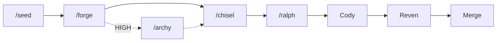

# Agent Squad

A personal multi-agent development workflow for Claude Code.

Forge -> Archy -> Chisel -> Ralph -> Cody -> Reven

Sidecar, on an existing branch: opens a worktree and stops (Cody only on
explicit opt-in — see "Sidecar" below)

/challenge -> Challenge, standalone, any time (stress-tests a proposal or
piece of writing before you commit to it — see "Challenge" below); also
runs as a required step inside `/forge` before a draft scope closes.

## MVP Flow

```text
/seed           First contact: create the vault mapping, initialize .squad/ AND scaffold second-brain project files.
                (The SessionStart hook orients each session; `/lore start` is setup/repair only.)
/clear          Reset session context.
/forge          Interactive discovery, writes output.yaml.
/archy          (HIGH only) Create PRD.
/chisel         Create tracker issues (GitHub in connected mode, a local batch file in detached mode).
/ralph          Execute issues in dependency order (invokes Cody). Connected: one stacked branch and PR per issue; detached: one branch per dependency chain.
                `/ralph --parent <n>` runs a container's sub-issues (default: most recent open container); `/ralph #1 #2` runs named issues.
                Skips `blocked` and `needs-review` issues unless named explicitly.
                Persists run state (order, branches, attempt counters) in `.squad/ralph-run.md` and offers resume.
Cody            Implement one issue on a branch cut from origin/<base> (local <base> in detached mode), with preferences and active decisions injected; open its PR.
Reven           Review each PR against its own base (stacked PRs show only their diff).
SessionEnd      lore-checkpoint hook rebuilds status.md (detached) when stale (worktree sessions append a checkpoint only); /lore recover rebuilds explicitly.

Checks (this repo)
Tier 1 (gate)   bash scripts/squad-lint.sh
                bash scripts/test-squad-labels.sh ; bash scripts/test-squad-branch.sh
                (and the other scripts/test-*.sh; hook-tests.yml on ubuntu + macOS, squad-lint.yml on ubuntu only)
Tier 2 (advisory) claude plugin eval claude/ ...   (see "Evals (tier 2)"; never gates a PR)
```

[](https://giorgiogalassi.github.io/agent-squad/flow.html)

The full picture, including the hooks, the side paths and a matrix of
which step reads and writes which memory file, lives in
[`docs/flow.html`](docs/flow.html), rendered at
<https://giorgiogalassi.github.io/agent-squad/flow.html>. The spine is:



The diagram shows the current manual MVP: `Lore` manages second-brain memory, `Seed` prepares context, `Forge`
structures the work, `Archy` appears only for `HIGH` complexity, `Chisel`
creates tracker issues (GitHub issues in connected mode, or a local batch
file in detached mode), `Ralph` drives execution through `Cody` — one
stacked branch and PR per issue in connected mode, one branch per
dependency chain in detached mode — and `Reven` reviews each PR against
its base before merge.

## Sidecar: iterating on an existing branch

The MVP flow above is sized for a batch of tracker issues. It's the wrong
tool for "this UI piece is wrong on the branch I already have out" —
re-running Forge and Chisel just to describe a fix to a branch that
already exists is pure ceremony, and talking straight to the codebase
instead leaves no trail in the vault.

`/sidecar <branch-name>` is the companion entry point for that case. It
does not touch Forge, Archy, Chisel, or Ralph. Given a branch that
already exists (typically one with an open PR, or one Ralph committed
but hasn't closed), it:

1. Creates a git worktree for that branch inside the project directory —
   a real, disposable working copy so you can run and test it without
   disturbing your main checkout.
2. Orients from the diff against the branch's base, not from a full
   re-read of prior planning docs.
3. Stops. You iterate with the model directly in the worktree, or in a
   separate session opened there. Cody runs only if you say "hand this to
   Cody", once, with `open pr: no`.
4. On "done": pushes and opens/updates the PR (or prints the paste-ready
   description in detached mode), writes one summary line to
   `progress.txt`, and removes the worktree.

The worktree is an intentional exception to the squad's usual
zero-footprint rule: unlike `.squad/` state, it is not squad memory, just
an ordinary disposable checkout, git-ignored in the host project and
gone by the time Sidecar closes. The evidence trail lands in the same
`progress.txt` Ralph already writes to — one line per Sidecar session,
not one per fix, since issues at this stage are small enough that a
session-level summary is enough. Sidecar is deliberately just open and
close: a Cody cold start per fix is the wrong granularity for iterative
tweaks, and a separate session per worktree already gives isolation
while keeping the conversational thread. Reven is never invoked automatically;
run it yourself when you're ready for another review pass.

## Challenge: stress-testing a proposal before you commit to it

`/challenge` invokes the `challenge` agent to poke holes in an idea,
plan, or piece of writing before you act on it: counter-arguments,
probing questions, a pre-mortem, at least one alternative, and a
`go` / `revise` / `reconsider` verdict per part. It only fires on an
explicit ask — "challenge this," "push back," "poke holes," "what do
you think about it?" — never automatically on every plan or draft.

It is not scoped to code or planning documents. The brief format
(proposal, goal, excerpt) and the four angles apply just as well to
non-development work — a speech draft, a pricing pitch, an email you're
about to send — as to a technical plan. Use it standalone any time,
in or out of a squad project:

```
/challenge   the pricing section of this proposal — does the discount
             structure actually make sense for the audience?
```

If the request bundles a change alongside the challenge ask ("split
slides 4–6 into two sections, what do you think?"), the skill shows the
challenge result and holds the change until you respond — agree,
revise, pick an alternative, or explicitly override ("just do it"),
which applies the change without re-arguing the points.

The `challenge` agent is stateless: it never touches the vault or
`.squad/` state, so it works identically inside a squad project or in
any other directory, with no history kept that a challenge happened.

`/forge` also invokes the same agent, twice: an **opening challenge** on
the raw input right after reading `architecture.md`, before any question
is asked, and a lighter **delta check** on just the decisions made
during the rounds, right before the close gate. Findings from the
opening challenge attach to whichever question they bear on once that
question becomes a root, rather than being asked as separate bolted-on
questions; the delta check never reopens a round — its findings go
straight to `open_questions` and `notes`. Fully-specified, low-complexity
input skips both steps (noted in `notes`) — there is still no
user-facing flag to skip it otherwise, so plans get the same scrutiny
before they are chiseled into issues.

## Stats: what Claude Code costs and what it produces

`/stats [--days <n>]` imports Claude Code transcripts into a store in the
vault (`<vault>/squad-stats/`), then writes a Markdown report and, next to
it, a self-contained HTML view of the same report with charts (daily cost
by session kind, cost per session by week, top skills) that opens
offline in any browser. It covers
every session, squad or not, and classifies each one as **squad** (used a
squad skill or agent), **custom** (another skill, command or agent) or
**vanilla** (built-in Claude Code only). The report has sessions by kind,
cost by skill and agent (with a Squad column), project and model, a
weekly per-session trend, cache hit ratio, Reven verdicts and, in
connected mode, the outcomes of the PRs recorded in `progress.txt`
(merged, open, rework proxy, hours to merge, squad cost per merged PR).

- **Comparing before and after a change** (a new skill, a token-saving
  tool): read the weekly trend, which is per session. It is a
  correlation, not an experiment: a week of heavy `/ralph` runs is not a
  week of small fixes.
- **Attribution is approximate.** A slash command you type stays active
  until the next command or a resetting built-in such as `/clear`; a skill
  the model loads on its own lasts until your next message, so a turn that
  loads a reference skill and then does unrelated work is charged to it. Prompt built-ins
  (`/init`, `/review`, `/compact`, ...) show as `builtin:<name>`; a new
  built-in missing from the script's list shows up as a custom skill.

- **Cost is the API list-price equivalent.** On a subscription it is a
  unit for comparing skills and agents, not your bill. Prices live in
  `squad-stats.py`; `<vault>/squad-stats/prices.json` overrides them, and
  an unknown model is reported as unpriced, never guessed.
- **Run it at least weekly.** Claude Code deletes transcripts older than
  `cleanupPeriodDays` (default 30). Rows already in the store survive;
  raising the setting in `~/.claude/settings.json` gives more slack.
- **Questions are the point.** After each report the skill asks what
  question the numbers raise and appends it to
  `<vault>/squad-stats/questions.md`. After a month, the questions that
  keep coming back are the KPIs worth keeping.
- **Source and model are separate.** The importer writes normalized rows
  (`usage.tsv`, `verdicts.tsv`); the report reads only those. An
  OpenTelemetry importer can be added later without touching the report.

Needs `python3` (standard library only). GitHub reads use `gh pr view`,
connected mode only.

## What's in this repo

```text
agent-squad/
  .github/
    workflows/
      issue-lifecycle.yml
                    On PR merge/close, closes the linked issue and clears
                    its state labels (in-progress/in-review/needs-review).
                    Label names are hardcoded here — not read from
                    chisel-config.json, which lives outside this repo.
  CLAUDE.md         Project instructions read by Claude Code sessions
  JOURNAL.md        Design journal: iterations, decisions, open points
  LICENSE
  PLATFORM_DIFFERENCES.md
                    Historical note: this repo maintained a parallel Codex
                    distribution until #148 removed it.
  PATH_RESOLUTION.md
                    Algorithm and rationale behind path-resolve.sh. Docs
                    only — never read at runtime; the script is what runs.
  README.md         This file
  assets/
    mvp-flow.mmd    Mermaid diagram of the MVP flow
  claude/
    skills/
      forge/        Interactive brainstorming -> .squad/forge/output.yaml
      archy/        Architecture analysis -> .squad/prd/current.md
      chisel/       YAML/PRD -> GitHub issues
      seed/         Project initialization -> .squad/ context files
      ralph/        Agentic loop invoking Cody
      sidecar/      Worktree-backed iterative fix session on an existing branch
      reven/        Slash-command wrapper delegating to the Reven agent
      lore/         Slash-command wrapper delegating to the Lore agent
      challenge/    Slash-command wrapper delegating to the Challenge agent
      stats/        Usage, cost and outcome report (squad-stats.py)
    agents/
      cody.md       Claude agent definition for implementation
      reven.md      Claude agent definition for review
      lore.md       Claude agent for second-brain memory
      challenge.md  Stateless agent that stress-tests a proposal or draft
    hooks/
      path-resolve.sh Shared vault/project-root resolution. Required —
                       every skill and agent calls it as step one.
      worktree.sh      create/path/remove/deps worktree lifecycle
                       mechanism (used today by Sidecar; Ralph's epic
                       mode will consume it too — see the "Worktree
                       hook" section below).
      lore-orient.sh   SessionStart read-only orientation script (optional)
      lore-checkpoint.sh
                       SessionEnd status.md refresh (optional)
      chisel-config-validate.py
                       Validates chisel-config.json shape
      squad-stats.py   Transcript importer and report behind /stats
```

## Installation

Squad is installed globally. No files need to be added to any host project.
After install, Squad is available in every project immediately.

> Warning: if you already have files named `lore`, `cody`, `reven`, `forge`,
> `archy`, `chisel`, `seed`, `ralph`, `challenge`, or `stats` in `~/.claude/agents/`
> or `~/.claude/skills/`, they will be overwritten by the commands below.

```bash
cp -r claude/agents/* ~/.claude/agents/
cp -r claude/skills/* ~/.claude/skills/
mkdir -p ~/.claude/hooks
cp claude/hooks/path-resolve.sh ~/.claude/hooks/ && chmod +x ~/.claude/hooks/path-resolve.sh
cp claude/hooks/chisel-config-validate.py ~/.claude/hooks/ && chmod +x ~/.claude/hooks/chisel-config-validate.py
cp claude/hooks/worktree.sh ~/.claude/hooks/ && chmod +x ~/.claude/hooks/worktree.sh
cp claude/hooks/squad-common.sh ~/.claude/hooks/ && chmod +x ~/.claude/hooks/squad-common.sh
cp claude/hooks/squad-labels.sh ~/.claude/hooks/ && chmod +x ~/.claude/hooks/squad-labels.sh
cp claude/hooks/squad-branch.sh ~/.claude/hooks/ && chmod +x ~/.claude/hooks/squad-branch.sh
cp claude/hooks/squad-incidents.sh ~/.claude/hooks/ && chmod +x ~/.claude/hooks/squad-incidents.sh
cp claude/hooks/squad-stats.py ~/.claude/hooks/ && chmod +x ~/.claude/hooks/squad-stats.py
```

`path-resolve.sh` is not optional: every skill and agent's "Path
resolution protocol" calls it as its first step (see
`PATH_RESOLUTION.md`). Without it installed, nothing in the squad can
resolve which vault project it's talking to. It prints five `KEY=value`
lines (`VAULT_PATH`, `PROJECT_ROOT`, `DISPLAY_NAME`, `SQUAD_DIR`,
`TRACKER_MODE`); `TRACKER_MODE` is `detached` unless `chisel.mode` in the
project's `chisel-config.json` is exactly `connected` (any doubt, including
a missing file or `jq`, means `detached`).

## Script layer

Steps that must be deterministic are scripts in `claude/hooks/`, and the
agent prose only calls them (the rule is in `CLAUDE.md`):

- `path-resolve.sh` prints the five path/mode lines, including `TRACKER_MODE`.
- `squad-common.sh` is the shared guard: `squad_gh_write` is the only
  mutating `gh` path and refuses in detached mode.
- `squad-labels.sh` (ensure, claim, review, escalate, with `--handoff`)
  moves issue labels; it makes zero `gh` calls in detached mode.
- `squad-branch.sh` (create, continue) handles branches, with no `gh`
  calls, worktree-safe, never `-f`, stash or reset. It resolves
  `origin/<base>`, then local `<base>`, and emits `BASE_REF`; detached mode
  tolerates a missing `origin`, so local-only stacks work without a remote.
- `squad-incidents.sh` (record, summary, resolve) is the global append-only
  incident store at `<vault>/squad-incidents.tsv`. `record` never writes
  stdout and always exits 0; `summary` lists signatures seen in 2+ sessions.

Output is `KEY=value` lines and exit codes 0, 2, 10 and 20, specified in
[`SCRIPT_CONTRACT.md`](SCRIPT_CONTRACT.md). `TRACKER_MODE` is resolved by
`path-resolve.sh`, never passed by a model, and defaults to `detached`
unless `chisel.mode` is provably `connected`. Run-state and PR scripts are
not scripted yet (planned batch 1b).

## Worktree hook

`claude/hooks/worktree.sh` extracts worktree lifecycle management
(create, locate, remove, dependency population) out of skill prose into
an executable, testable mechanism. Sidecar consumes it today — Phases 2,
2b, 2c, and 5 all call into it — and Ralph's future epic mode is
specified against the same `create`/`path`/`remove`/`deps` contract.

It follows `path-resolve.sh`'s conventions: `KEY=VALUE` lines on
stdout, mechanism only (no policy — Sidecar still owns when to warn,
what to say, and when to ask the user for confirmation), no interactive
prompts. It resolves its own project root via `path-resolve.sh`
(expected as a sibling file) and never calls
`git rev-parse --show-toplevel`, which returns a linked worktree's own
directory rather than the main project's when run from inside one.

Exit codes: `0` success, `1` a refusal the caller must surface (never a
forced operation), `2` an internal error.

```bash
worktree.sh create <branch>          # WORKTREE_PATH=..., WORKTREE_CREATED=true|false
worktree.sh path <branch>            # WORKTREE_PATH=...
worktree.sh remove <branch>          # REMOVED=true|false, CLEANED=<paths>
worktree.sh deps <worktree-path>     # DEP=<rel>|<outcome>|<tier>|<seconds> and STALE=<rel>|<kind> lines
```

Depends only on `git` and POSIX shell utilities — no `jq`.

Install alongside `path-resolve.sh`:

```bash
cp claude/hooks/worktree.sh ~/.claude/hooks/ && chmod +x ~/.claude/hooks/worktree.sh
```

Hooks are consumed from `~/.claude/hooks/`, not from the checkout — a
reinstall (re-running the copy command above) is required before this
change takes effect for any skill that starts calling it.


`chisel-config-validate.py` is an optional CI-style gate that checks
every `chisel-config.json` in the vault against the schema documented in
`claude/skills/chisel/SKILL.md`. It is not invoked automatically
by any skill or agent — run it manually (`--prune` to remove flagged
keys; read-only otherwise).

### Optional: SessionStart auto-orientation

A read-only hook can inject "where you left off" at the start of every
session, so you do not have to ask. It never writes and never blocks. It
also calls `path-resolve.sh`, so install that first if you haven't.

```bash
cp claude/hooks/lore-orient.sh ~/.claude/hooks/ && chmod +x ~/.claude/hooks/lore-orient.sh
```
Then add to `~/.claude/settings.json`:
```json
{ "hooks": { "SessionStart": [ { "hooks": [
  { "type": "command", "command": "~/.claude/hooks/lore-orient.sh" } ] } ] } }
```

It also prints up to two signal lines, omitted when not applicable:
`Architecture snapshot older than <file>; run /seed` (architecture.md is
older than the newest manifest or lockfile at the project root) and
`status.md over budget; next rebuild compresses` (over ~300 words).

The hook orients (read-only). `/lore start` is setup and repair only
(migrating a legacy `.squad/`, re-mapping a moved checkout, INDEX active
project); it is not a per-session step.

### Optional: SessionEnd status refresh

`status.md` otherwise rebuilds only through `lore recover`. This hook keeps
it current when a session ends. It never blocks exit; any failure prints
one line and exits 0. Needs `path-resolve.sh`; `jq` is optional (without it the hook falls back to `$PWD` instead of the session `cwd`).

- Session in a linked worktree: appends one checkpoint line for the
  branch (capped to the last 3), never rebuilds.
- Session on the main checkout: if status is stale (checkpoint newer than
  Last updated, or Last updated older than 7 days), runs a headless
  `claude -p` reconstruct from git evidence (skipped when there are no
  commits since `Last updated`). `## Blocked` is preserved verbatim,
  checkpoints capped to 3, Goal/Done/Next rejected if over ~400 tokens.
  Fresh status: no write. Commits the vault if it is a git repo.
- Budget: Claude Code gives SessionEnd hooks 1.5 s by default, so the
  rebuild runs detached (own session, stdio redirected, one lock per
  project, hard 90 s cap via `timeout` or a perl alarm) and exit is never
  delayed. Its log is `<vault>/projects/<name>/.lore-checkpoint.log`.
  To give the synchronous part more time, add `"timeout": <seconds>` to the
  hook entry (the budget rises to the highest per-hook timeout, up to 60 s).
- Checkpoint lines: `lore-checkpoint.sh --note "<line>"` inserts one inside
  `## Last checkpoint` (cap 3); stray dated lines under `## Context refs`
  are moved there on the next run.
- Model: `SQUAD_LORE_MODEL` (default `haiku`).

```bash
cp claude/hooks/lore-checkpoint.sh ~/.claude/hooks/ && chmod +x ~/.claude/hooks/lore-checkpoint.sh
```
Then add to `~/.claude/settings.json`:
```json
{ "hooks": { "SessionEnd": [ { "hooks": [
  { "type": "command", "command": "~/.claude/hooks/lore-checkpoint.sh" } ] } ] } }
```

## Quick start

Once installed, open any project and run:

```bash
/seed
/clear
/forge <your idea>
```

## Vault setup

On the first `/seed`, Seed creates the vault mapping (and the vault, after asking) automatically.

- Default vault location: `~/second-brain/`
- Override with the `SECOND_BRAIN_PATH` environment variable:
  `export SECOND_BRAIN_PATH=/path/to/your/vault`
- `lore-config.json` lives at the vault root (`~/second-brain/lore-config.json`
  by default).
- Per-project `.squad/` state lives inside the vault at
  `<vault>/projects/<project-name>/.squad/`, not in the host project directory.
- Optional per-project `context` in `lore-config.json`
  (`"context": {"<project root>": "repo"}`, default `vault`) moves project
  knowledge (`architecture.md`, `scout-cache.md`, `forge/`, `prd/`) to
  `<project>/.squad/` so it is versioned with the code. `path-resolve.sh`
  reports the choice as `SQUAD_DIR`. Status, decisions, preferences and
  session log stay in the vault. Never both; keep client repos on `vault`.
- Recommended: initialize the vault as a private git repository. It is the
  single source of truth for all squad memory; a repo gives it history,
  backup, and multi-machine sync at zero cost. When the repo exists,
  `lore start` (setup), `lore prefer`, and `lore recover` commit after their
  writes (commit only, never push); pulling and pushing stay manual. Pull
  before starting work when using multiple machines.

Host projects have zero Squad footprint — no `.squad/` directory, no config
files are written to the project itself — unless configured `context: repo`.

## Workflow data

All runtime files live in the vault, not in your project directory.
Agent Squad does not modify `CLAUDE.md`; skills and agents read
vault files directly when needed.

```text
~/second-brain/                    (or $SECOND_BRAIN_PATH)
  lore-config.json                 Vault config. Written by Lore on first start.
  INDEX.md                         Vault entry point. Read by all companions via Lore at session start.
  preferences/
    development.md                 Global cross-tool preferences. Written by Lore via `lore prefer`. Capped at 100 lines.
  projects/<name>/
    .squad/
      architecture.md              written by Seed
      scout-cache.md               written by Seed
      decisions.md                 maintained by you
      forge/output.yaml            written by Forge
      forge/archive/               archived by Chisel
      prd/current.md               written by Archy
      prd/archive/                 archived by Chisel
      chisel-config.json           written on first Chisel run
      issues/                      detached-mode batch files and handoffs
      progress.txt                 Ralph's per-issue batch memory, and Sidecar's one-line-per-session summary. Read by Cody.
    golden.md                      Golden Q&A template. Created by Seed if absent, never overwritten.
    status.md                      Resumption handoff. Reconstructed by the SessionEnd hook or `lore recover`. Checkpointed by Cody at PR open.
    decisions.md                   Key decisions log. Entries retire via `Supersedes:`/`Superseded by:` markers; 60 active cap, overflow to `decisions-archive.md`. Written by Lore on both platforms. Fed back: Forge reads the last 20 active decisions, Ralph injects `development.md` plus that tail into every Cody prompt, and Reven reads both before reviewing.
```

Sidecar is the one exception to "all runtime files live in the vault": its
git worktree (`.claude/worktrees/<branch>/`) lives inside the host project
itself, git-ignored there, and is removed when the session closes. This
path matches Claude Code's own native worktree convention
(`--worktree`, `EnterWorktree`, subagent `isolation: worktree`), so it
lands exactly where most Claude Code users already expect worktree
content, and often where their `.gitignore` already excludes. It is a
disposable working copy, not squad state, so it does not follow the
zero-footprint rule above.

## Tracker modes

`chisel.mode` in `chisel-config.json` selects how the squad talks to your
issue tracker. `connected` (default) creates and updates GitHub issues and
opens PRs, both via `gh`; there is no tracker to choose between in this
mode. `detached` keeps agents fully hands-off:
Chisel writes a local batch file (with a Jira-importable CSV), Ralph
executes from it and produces a handoff checklist you replay into the
tracker, Cody commits locally and prints a paste-ready PR description
without pushing. Use detached in work environments where agents must not
hold write access to company tools, or as a fallback when the tracker MCP
is down. The thinking layers (Forge, Archy, Seed, Lore, Reven's review
logic) are identical in both modes.

### Installing the issue-lifecycle workflow (connected mode)

`.github/workflows/issue-lifecycle.yml` in *this* repository is what
reconciles Agent Squad's own issues. It is not something a project using
the squad in `connected` mode already has — connected-mode issues live
in *your* project's repository, and this workflow only ships inside
`agent-squad/.github/`, so nothing installs it there automatically. No
agent in the squad writes CI configuration into your repository on your
behalf: creating issues and labels via `gh` is a small, per-action,
reviewable operation; committing a GitHub Actions workflow that runs on
every PR close and can close issues is a standing change to your CI
pipeline, and that decision is left to you.

To get the same terminal-state reconciliation (closing an issue and
clearing its state labels when the linked PR merges, clearing
`in-review` when a PR closes without merging, and restoring `in-review`
if the issue is later reopened) in your own project:

1. Copy `.github/workflows/issue-lifecycle.yml` from this repository
   into your project's `.github/workflows/`.
2. Create the labels it expects to exist, if they don't already (Chisel
   creates these for you on every connected run in your project, so
   if Chisel has already run there you can skip this step):
   - `in-progress`
   - `in-review`
   - `needs-review` (or whatever you set `review_label` to in
     `chisel-config.json` — see the note below)
3. In your repository's Settings → Actions → General, set "Workflow
   permissions" to "Read and write permissions". The workflow requests
   `issues: write` in its own `permissions:` block, but that setting
   can still force it read-only and cause 403s on label removal or
   issue close.

The three label names above (`in-progress`, `in-review`, `needs-review`)
are hardcoded inside the workflow file, not read from
`chisel-config.json` (that file lives in your vault, outside the repo,
and is not available to a GitHub Actions runner). If you customize
`state_labels` or `review_label` in your vault config, edit the
`STATE_LABELS` list in your copy of the workflow to match, or the two
will silently drift apart. No agent merges PRs or performs this
reconciliation step itself — see the comments in
`.github/workflows/issue-lifecycle.yml` for the full resolution logic
and label-name caveats.

When using the squad across trust domains (personal and work), use one
vault per domain via `SECOND_BRAIN_PATH`, for example with direnv or a
shell profile on the work machine. Do not share a vault between domains:
INDEX.md and preferences are written on every session and would carry
work context into a personal remote.

## Plugin manifest (eval-only)

`claude/.claude-plugin/plugin.json` contains only `{"name":"agent-squad"}`.
It exists so `claude plugin validate claude/` (run in CI) and the
tier-2 eval suite can load `claude/` as a plugin. It is not an install path:
the runtime install is still the copy into `~/.claude/` described above, with
hooks wired in `~/.claude/settings.json`. There is deliberately no
hooks manifest under `claude/hooks/`; it would double-fire every hook for anyone who
loads `claude/` as a plugin next to the copy install.

## Evals (tier 2)

`claude/evals/` holds three advisory `claude plugin eval` cases that the bash
tests cannot cover, because they check what the agent *prose* does:

| Case | Checks (zero-cost graders only) |
|------|---------------------------------|
| `connected-claim` | Cody runs `squad-labels.sh claim` in a connected fixture |
| `detached-claim` | no Bash call contains `gh`; a handoff line `- [ ] Move ... to In Progress` is written |
| `worktree-continue` | Cody runs `squad-branch.sh continue` from a worktree and reports `HEAD_SHA=` |

Each case has a `scaffold.sh` (sharing `claude/evals/lib/scaffold-common.sh`)
that, inside the run's temporary `$HOME`, copies `claude/hooks/*.sh` to
`$HOME/.claude/hooks/`, builds a fixture with `scripts/fixtures/make-fixture.sh`
inside the workspace, and writes `$HOME/second-brain/lore-config.json` plus the
fixture's `chisel-config.json`. The agent finds the repo at `project/` (and
`worktree/`) in its workspace. The `gh` shim must be first on `PATH` for the
agent; the launcher provides that, and the first case prints `which gh`.

Run locally (needs `ANTHROPIC_API_KEY` or a logged-in `claude`; costs a few
tenths of a dollar per run, capped by `--max-cost-usd`):

```bash
PATH="$PWD/scripts/gh-shim:$PATH" claude plugin eval claude/ \
  --trust-plugin --ablation none --scaffold \
  --allow-tools 'Bash(*squad-labels.sh *)' 'Bash(*squad-branch.sh *)' \
    'Bash(*path-resolve.sh*)' 'Bash(git *)' \
  --max-cost-usd 5 --model claude-sonnet-5-5 --threshold 0 \
  --no-publish --json /path/outside/repo/results.json
```

`--threshold 0` keeps the suite advisory (the CLI default of 1.0 exits 1 on
any imperfect score). The suite is advisory: it never gates a PR. CI runs it
from `.github/workflows/plugin-eval.yml` on `workflow_dispatch`, or on a
same-repository pull request labeled `eval` (never on forks); it uploads
`results.json` and `report.html`, and is red only on exit code 1 (cases failed
to load). Do not commit the results directory the CLI creates under the eval dir
(`claude/evals/.gitignore` ignores it).

The `detached-claim` `handoff-line` grader is expected to fail today:
`claude/agents/cody.md` skips the detached claim (Ralph records it in the
handoff via `squad-labels.sh claim --handoff`, added in #217), so that case
scores 0.5 by design until the grader is re-pointed at Ralph's handoff line.

Findings from building it (Claude Code 2.1.296):

- Eval runs use a temporary `HOME`, with the workspace at `$HOME/cwd`; the
  scaffold runs with the same `HOME` and cwd.
- Bash inside the sandbox may write under `$HOME/second-brain/...` (verified
  with an `echo > $HOME/second-brain/y`, exit 0), so the vault lives there and
  no `SECOND_BRAIN_PATH` override is needed. Writes outside `HOME` and the
  workspace (for example the system temp dir) are denied.
- `--allow-tools` takes the `Bash(*x*)` wildcard form as written above. Only
  commands matching a pattern run, so a compound command with a pipe, `pwd` or
  `head` is denied; the prompts tell Cody to keep to single simple commands.
- The `agent-squad:` plugin prefix has no runtime impact: the agent is invoked
  as `agent-squad:cody` and the same prose and `~/.claude/hooks/` scripts run.
- On macOS the stock `/usr/bin/git` shim fails inside the sandbox (it cannot
  write its xcrun cache in the system temp dir), which breaks `path-resolve.sh`
  and `squad-branch.sh` locally; the Linux CI runner is expected to be unaffected (not yet exercised via
  workflow_dispatch). Expect
  lower scores on macOS unless a Homebrew `git` comes first on `PATH`.
- Cody's prose skips the claim in detached mode, so the `detached-claim`
  handoff-line grader mostly reports whether Ralph's handoff contract is
  followed; treat it as a signal, not a failure.

## Further reading

`JOURNAL.md` contains the full design history: why each component exists,
what was tried and rejected, and when to add the next layer.
